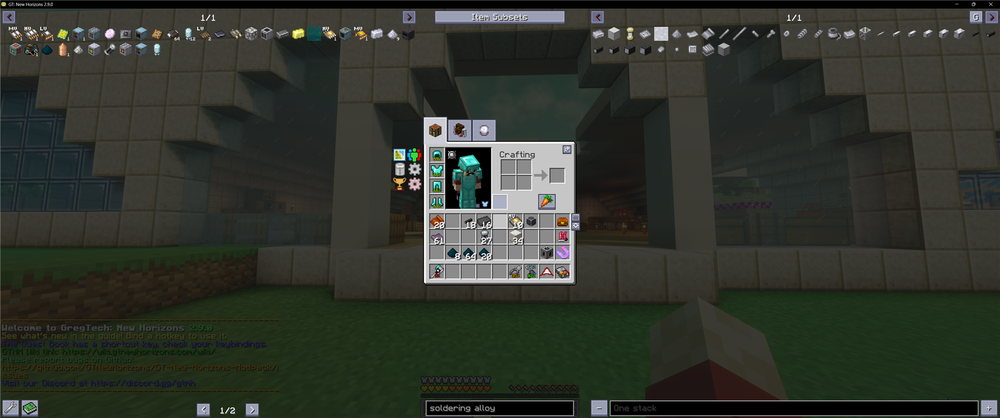
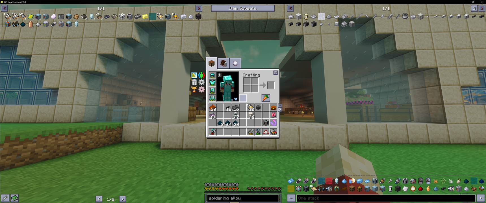

# GuiOpacity

A client-side mod for Minecraft 1.7.10 (GT New Horizons) that reduces the dark overlay drawn behind inventories and other GUIs.

> **Status: WIP.** It doesn't remove the overlay on most machines yet.

## Comparison

| Mod off (vanilla) | Mod on |
|---|---|
|  |  |

## Install

1. Download the jar from the Releases page.
2. Put it in your instance's `mods` folder.
3. Start the game once to generate `config/guiopacity.cfg`.

## Config

Change it in game via **Mods → GuiOpacity → Config**, or edit `backgroundOpacity` in `config/guiopacity.cfg`.

- `1.0`: vanilla overlay
- `0.5`: half as dark (default)
- `0.0`: no overlay

## Manual Build

```
./gradlew build
```

The jar is written to `build/libs/`. Use the one without a `-dev` or `-sources` suffix.

## License

MIT

## Versioning and releases

The version comes from the git tag. Use plain `MAJOR.MINOR.PATCH` tags with no `v` prefix (enforced by `versionPattern` in `gradle.properties`). Untagged builds get a name like `guiopacity-<commit>-main+<hash>[-dirty]`.

To cut a release:

```
git tag 0.1.0
git push origin 0.1.0
```

The `Release` workflow then builds the jar and publishes a GitHub release with it.
